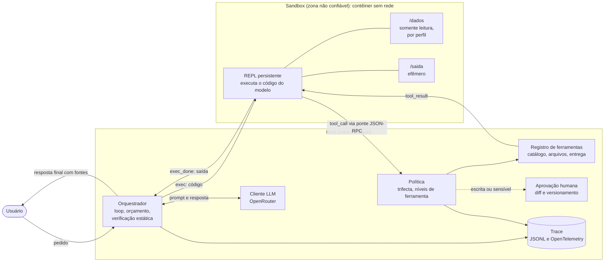

# agent-repl-security

Harness de agente em que o modelo responde a pedidos escrevendo código Python, executado num REPL persistente e isolado (contêiner sem rede), que chama ferramentas do host por uma ponte controlada e devolve ao modelo só o resultado relevante.

Projeto de estudo, com dados sintéticos. Combina duas ideias: código como espaço de ações (CodeAct) e ferramentas como API de código carregada sob demanda (Code Mode). O foco é segurança: isolamento do sandbox, política contra a *lethal trifecta*, aprovação humana para escrita e defesa contra prompt injection.

## O que é um REPL

REPL (*Read-Eval-Print Loop*) é um interpretador interativo: lê um trecho de código, executa, imprime o resultado e mantém o estado (variáveis, arquivos de trabalho) entre uma execução e a próxima. É o que acontece ao abrir `python` no terminal.

Num harness REPL, a "ação" do modelo deixa de ser uma chamada JSON por ferramenta e passa a ser um bloco de código. Esse código pode chamar várias ferramentas, guardar resultados em variáveis e filtrar os dados antes de devolver ao modelo só o que importa. Dados intermediários e arquivos grandes ficam no REPL, fora do contexto do modelo.

Como o código vem do modelo, ele é tratado como hostil: roda num contêiner sem rede, e tudo que precisa do mundo externo atravessa uma ponte controlada pelo host.

## Visão geral

O modelo emite um bloco de código por turno; o orquestrador o verifica e o envia ao sandbox; o sandbox executa e devolve a saída truncada. Toda chamada de ferramenta passa pela ponte e pela política no host antes de chegar ao registro. Alterações em documentos só são gravadas depois de diff, validação e aprovação humana. Detalhes na [especificação](docs/especificacao-v0.md).

## Estado

Fase de especificação: ainda não há código.

## Documentação

- [Especificação v0](docs/especificacao-v0.md)
- [Decisões de arquitetura (ADRs)](docs/adr/README.md)
