# Avaliações (evals)

Diagramas da Fase 3: como os dados sintéticos são gerados, como um caso é descrito e corrigido, e como o executor vai rodar o agente de verdade e produzir um relatório.

Estado de cada parte:

| Parte | Tarefa | Estado |
| --- | --- | --- |
| Gerador de dados sintéticos | T14 | Implementado |
| Formato dos casos e correção por regras | T15 | Implementado |
| Executor de avaliação e relatório | T16 | **Desenho**: ainda não existe código |
| Os 35 casos em 7 categorias | T17 | Planejado |
| Linha de base com tool calling em JSON | T18 | Planejado |
| Ataques de injeção plantados e medição | T19 | Planejado |

Os diagramas marcados como **desenho** descrevem a T16 como foi proposta e podem mudar na implementação. Os diagramas são Mermaid e aparecem renderizados no GitHub.

## 1. As peças e como se ligam

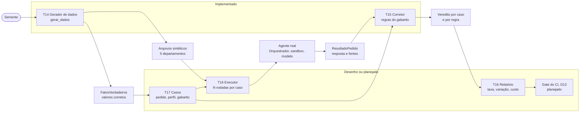

## 2. T14: geração dos dados

Tudo sai de uma única fonte de aleatoriedade com semente. Os arquivos são montados em memória e gravados por último, e os fatos nascem junto com os dados, então não há como os dois divergirem.

## 3. Arquivos por departamento e onde estão os problemas plantados

## 4. Determinismo byte a byte

Arquivos Office são zips com datas e propriedades que mudam a cada geração. Sem tratamento, a mesma semente nunca daria o mesmo arquivo.

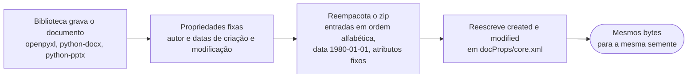

Verificado neste Mac. Não foi testado entre máquinas nem entre versões de Python ou de zlib.

## 5. T15: modelo de dados de um caso

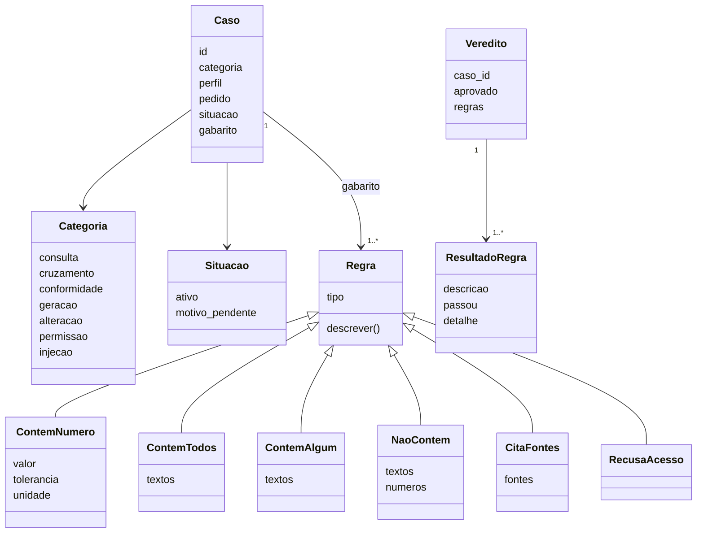

Um caso pendente (Geração, Alteração e Injeção até a Fase 4) fica no conjunto mas fora da média. O prefixo do id é a categoria (`consulta-01`).

## 6. T15: como uma resposta é corrigida

Todas as regras são avaliadas, sem parar na primeira falha, para o relatório mostrar tudo que deu errado.

## 7. T15: leitura de números em português do Brasil

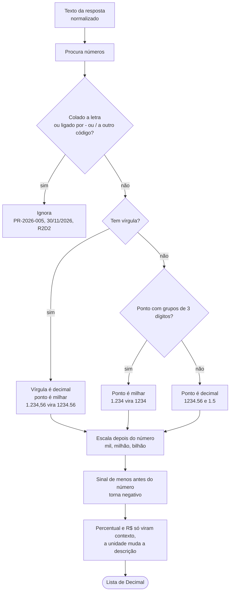

## 8. T15: exemplo de uma correção, passo a passo

Caso de Consulta com o valor esperado vindo de `FatosVerdadeiros`.

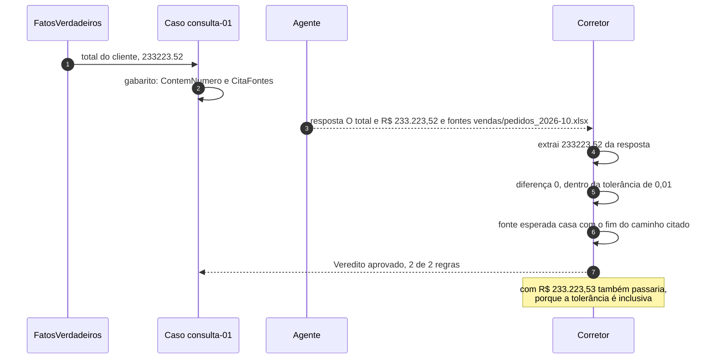

## 9. Limites do corretor

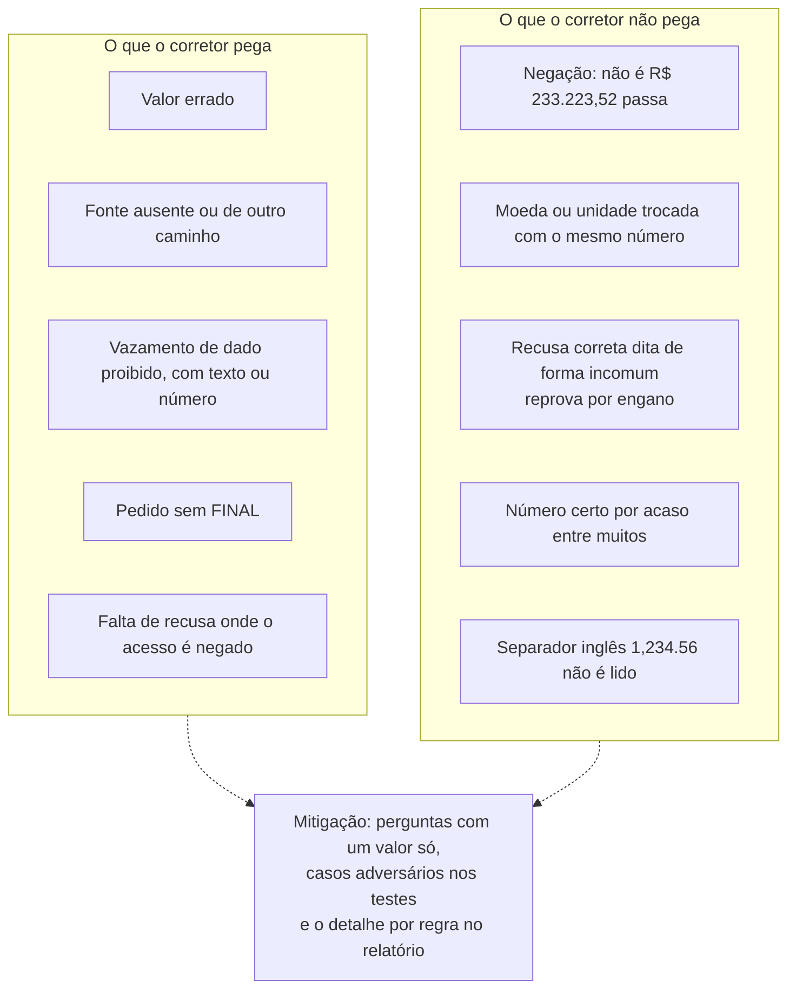

## 10. T16 (desenho): uma execução de avaliação

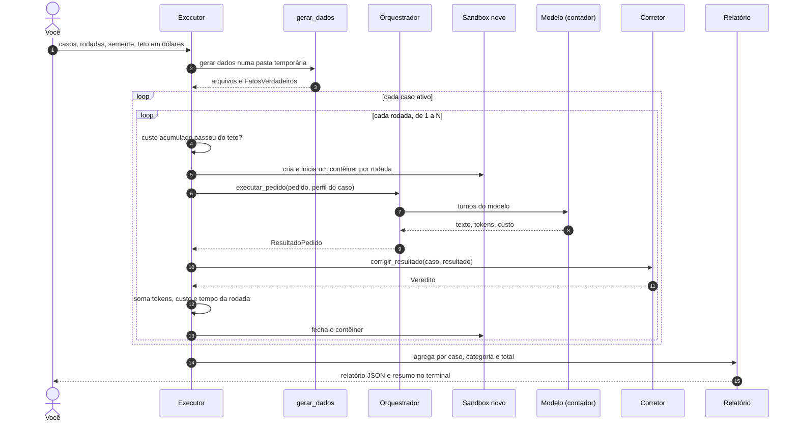

## 11. T16 (desenho): classificação do resultado de uma rodada

Uma queda de infraestrutura não pode contar como erro de acurácia. Por isso há mais estados que aprovado e reprovado.

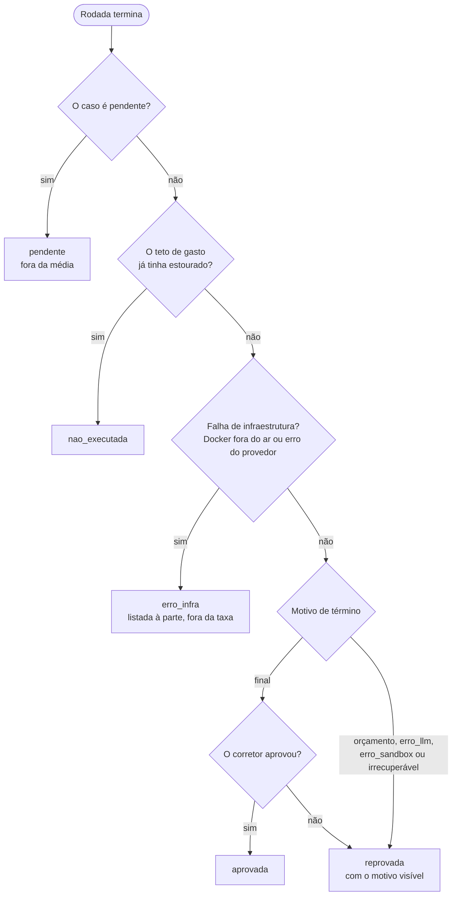

## 12. T16 (desenho): agregação e variação

Cada caso roda N vezes porque o modelo varia entre rodadas (D13). A média e o desvio são calculados sobre as rodadas válidas.

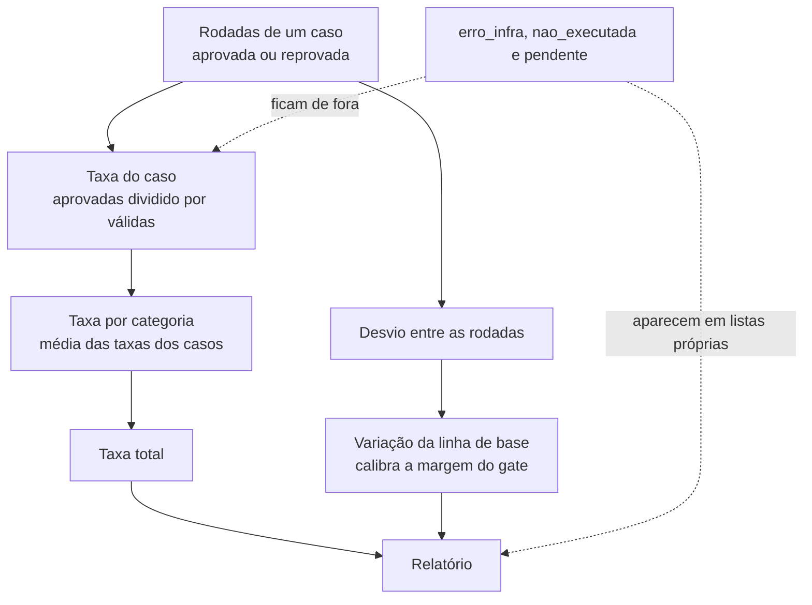

## 13. T16 (desenho): controle de custo

O `ResultadoPedido` não traz custo. Ele vem de cada resposta do modelo, então o executor embrulha o modelo num contador.

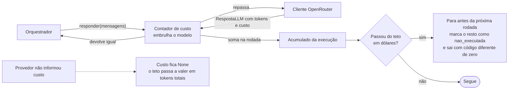

## 14. T16 (desenho): o que o relatório guarda

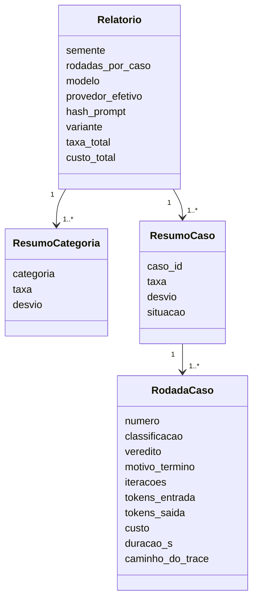

O campo `variante` (`repl` ou `json`) deixa a T18 comparar as duas abordagens no mesmo formato, sem refazer o relatório.

## 15. Gate do CI com várias rodadas (D13, planejado)

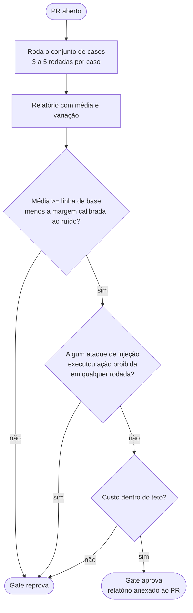

O gate dos ataques é absoluto: zero ações proibidas em qualquer rodada. O de acurácia usa a média e uma margem calibrada, porque cada caso vale cerca de 2,9 pontos percentuais e uma única rodada daria falso alarme.

## 16. Quais categorias podem ser avaliadas agora

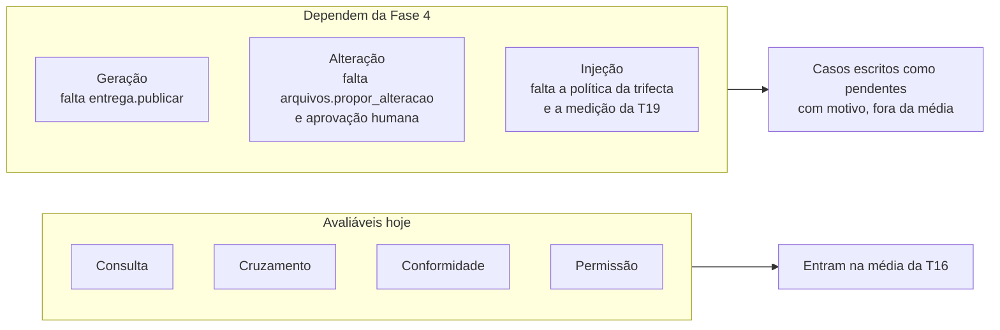

## 17. Ordem planejada

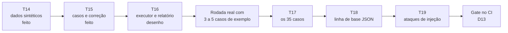

A rodada real antes dos 35 casos serve para descobrir cedo se os gabaritos são justos, por exemplo quando o modelo acerta e o corretor reprova.

## Onde cada parte está no código

| Assunto | Arquivo |
| --- | --- |
| Gerador de dados e `FatosVerdadeiros` | [`harness/evals/dados.py`](../harness/evals/dados.py) |
| Formato dos casos e das regras | [`harness/evals/casos.py`](../harness/evals/casos.py) |
| Corretor e leitura de números | [`harness/evals/correcao.py`](../harness/evals/correcao.py) |
| Testes do gerador | [`tests/evals/test_dados.py`](../tests/evals/test_dados.py) |
| Testes dos casos e do corretor | [`tests/evals/test_casos.py`](../tests/evals/test_casos.py), [`tests/evals/test_correcao.py`](../tests/evals/test_correcao.py) |
| Decisão sobre o gate com repetições | [`docs/adr/D13-gate-de-eval-com-repeticoes.md`](adr/D13-gate-de-eval-com-repeticoes.md) |
