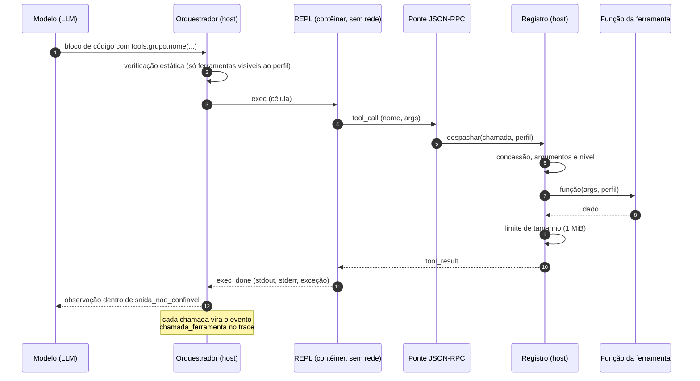
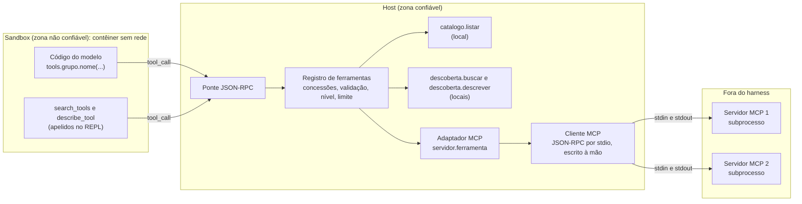
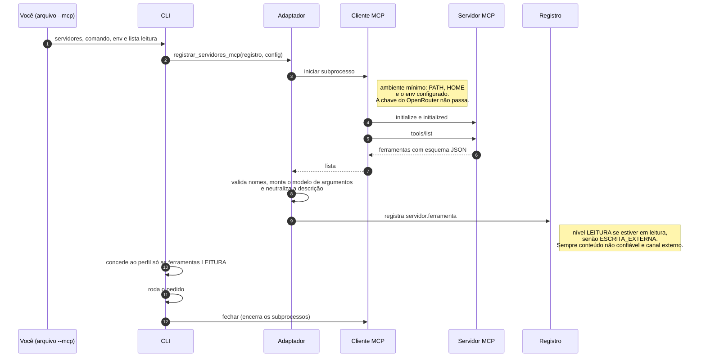
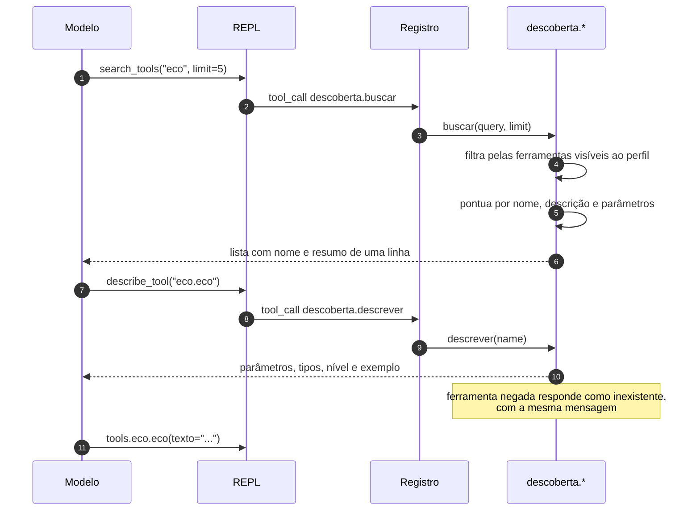
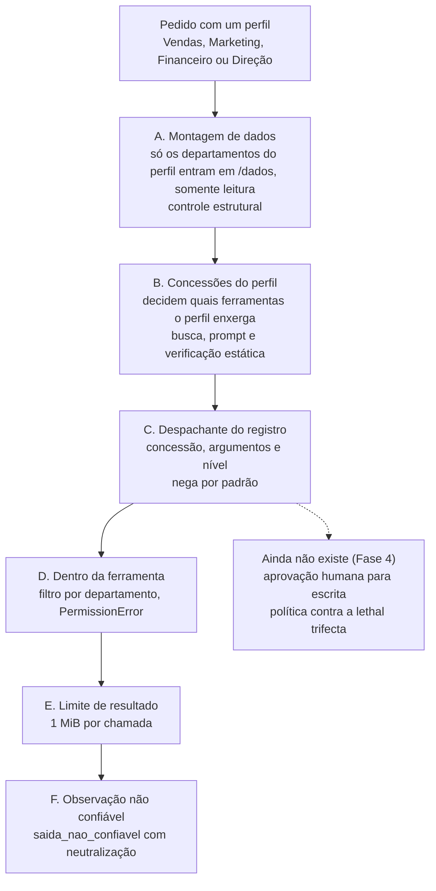
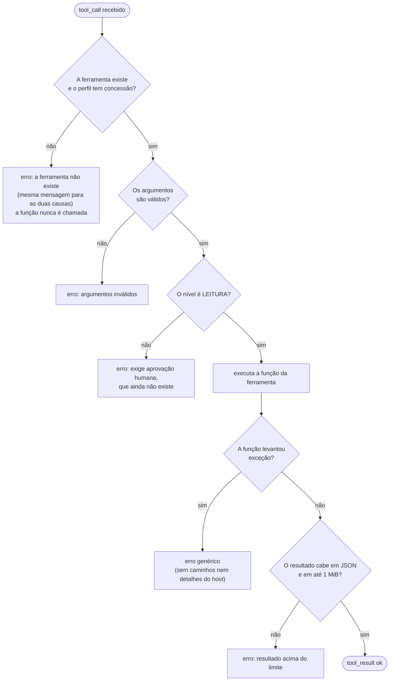
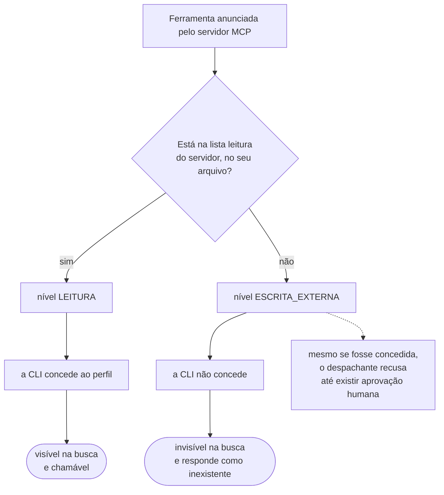

# Ferramentas, MCP e permissões

Diagramas de como o harness chama ferramentas, liga servidores MCP e decide o que cada perfil pode ver e executar. Descrevem o código da Fase 1 e da Fase 2 (T1 a T13). A aprovação humana e a política contra a *lethal trifecta* são da Fase 4 e ainda não existem.

Os diagramas são Mermaid e aparecem renderizados no GitHub.

## 1. Como uma chamada de ferramenta acontece

O modelo nunca chama uma ferramenta diretamente: o código dele roda no contêiner, e cada chamada atravessa a ponte até o host, onde o registro decide.

## 2. Ferramentas locais e servidores MCP

As ferramentas locais e as de MCP vivem no mesmo registro. O sandbox não sabe a diferença, e os servidores MCP rodam no host, nunca no contêiner.

## 3. Como um servidor MCP entra no registro

Acontece uma vez por execução, antes do pedido, só para os servidores que você declara em `--mcp`. Nada é descoberto sozinho.

## 4. Descoberta de ferramentas sob demanda

O prompt traz só os nomes dos grupos que o perfil enxerga. O modelo busca e descreve o resto por código.

## 5. Camadas de permissão

Nenhuma camada sozinha basta. Cada uma cobre uma falha possível das outras.

## 6. Decisão do despachante, passo a passo

Ordem real do `Registro.despachar`. Qualquer falha devolve um erro curto ao código do modelo, sem derrubar o pedido.

## 7. Perfis e concessões

Os quatro perfis embutidos. As concessões base valem para todos.

| Perfil | Departamentos montados em `/dados` | Concessões |
| --- | --- | --- |
| Vendas | vendas, comercial | `catalogo.listar`, `descoberta.*` |
| Marketing | marketing | `catalogo.listar`, `descoberta.*` |
| Financeiro | financeiro, vendas, comercial | `catalogo.listar`, `descoberta.*` |
| Direção | vendas, comercial, marketing, financeiro, direcao | `catalogo.listar`, `descoberta.*` |

A CLI soma a isso as ferramentas MCP de nível `LEITURA` do arquivo `--mcp`. Uma concessão é um nome exato (`catalogo.listar`) ou um grupo inteiro (`descoberta.*`). Sem concessão, a ferramenta não existe para o perfil.

## 8. Nível e visibilidade de uma ferramenta MCP

O MCP não diz se uma ferramenta lê ou escreve. Por isso o padrão é o nível mais restrito, e só você o libera.

## Onde cada parte está no código

| Assunto | Arquivo |
| --- | --- |
| Registro e despachante | [`harness/host/registry.py`](../harness/host/registry.py) |
| Perfis e concessões | [`harness/host/perfil.py`](../harness/host/perfil.py) |
| Descoberta de ferramentas | [`harness/host/tools/descoberta.py`](../harness/host/tools/descoberta.py) |
| Adaptador, cliente e configuração MCP | [`harness/host/mcp/`](../harness/host/mcp/) |
| Ponte no sandbox | [`harness/sandbox/tools_client.py`](../harness/sandbox/tools_client.py) |
| Decisão sobre concessões | [`docs/adr/D14-perfis-por-ferramenta.md`](adr/D14-perfis-por-ferramenta.md) |
