# Fluxo do pedido, protocolo e módulos

Diagramas de como um pedido anda do começo ao fim: o loop do orquestrador, o protocolo da ponte, o contexto, o cliente do modelo, o trace e o mapa de módulos. Completam os diagramas de [ferramentas, MCP e permissões](diagramas-ferramentas-e-permissoes.md) e de [segurança e defesa](diagramas-seguranca.md), e descrevem o código das Fases 1 e 2 (T1 a T13).

Os diagramas são Mermaid e aparecem renderizados no GitHub.

## 1. Um pedido, de ponta a ponta

O caminho feliz: o modelo escreve código, o sandbox executa, uma ferramenta do host é chamada, e o `FINAL` encerra o pedido.

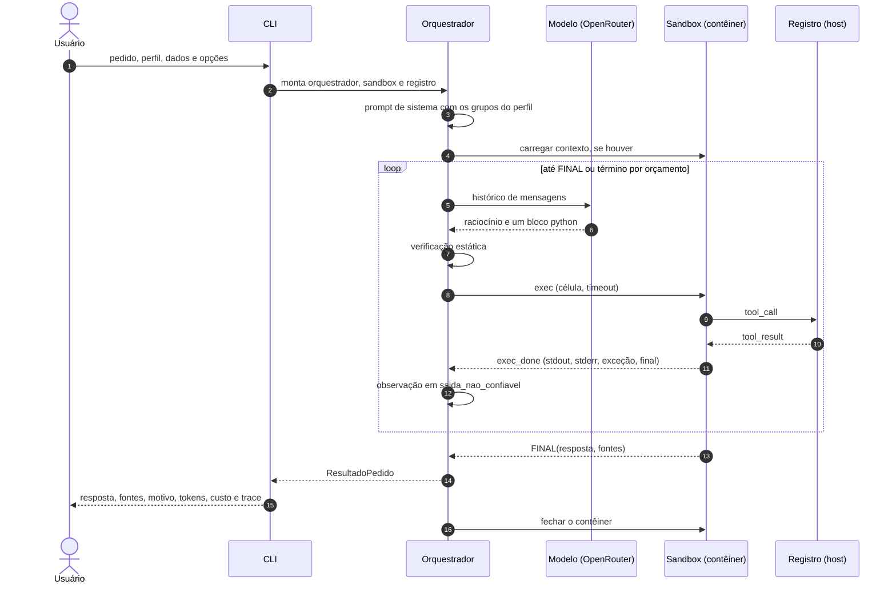

## 2. Estados de um pedido

Um pedido sempre termina com um destes motivos. Só `final` é um pedido completo.

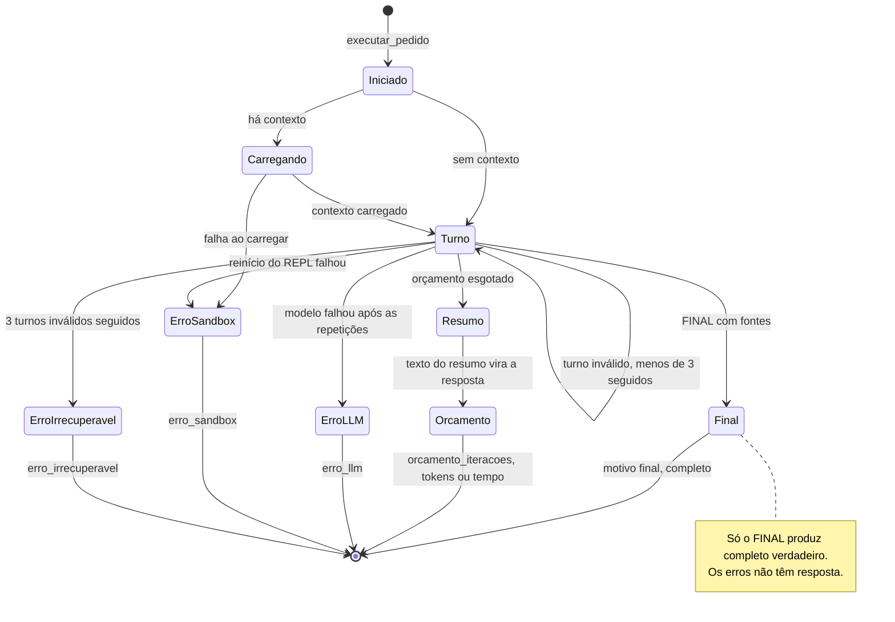

## 3. O que acontece em cada turno

Cada resposta do modelo passa por filtros baratos antes de chegar ao contêiner. Turno inválido não executa nada e conta para o limite de três seguidos.

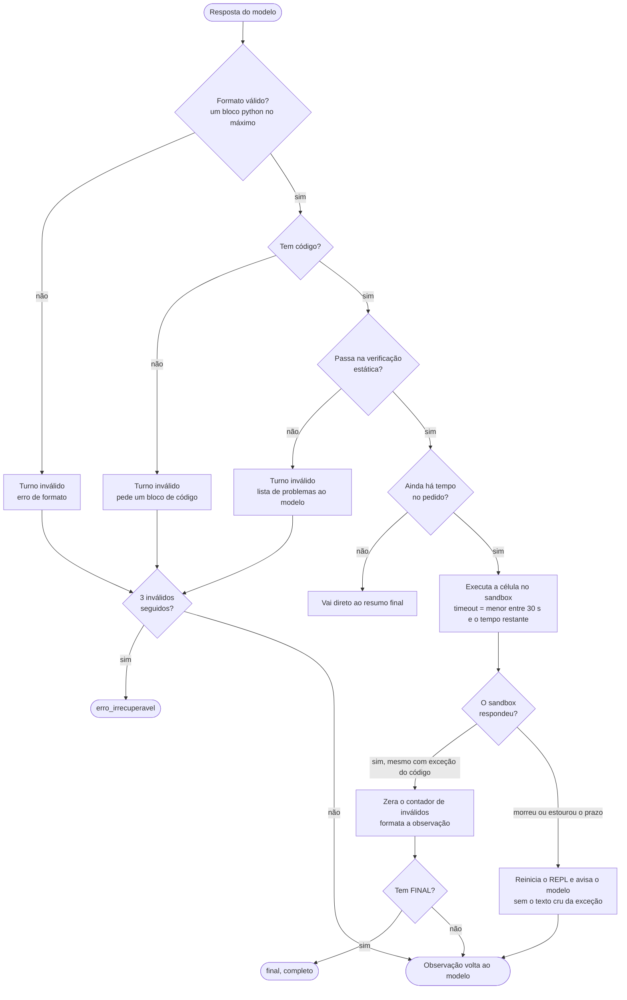

## 4. Orçamento e resumo final

O orçamento é conferido antes de cada chamada ao modelo. Ao estourar, o pedido não é cortado em silêncio: o modelo recebe um último turno, sem código, para resumir o que conseguiu.

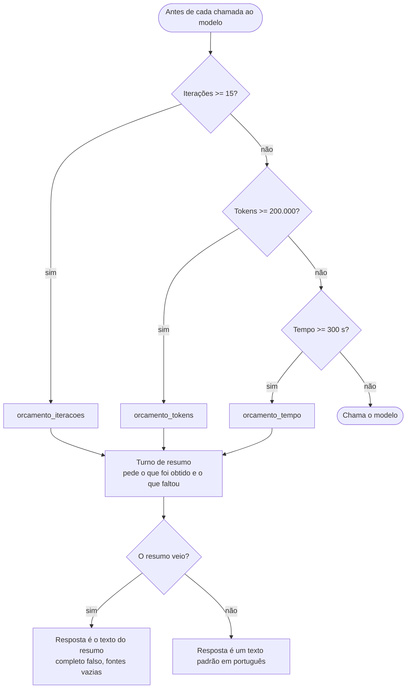

Com `max_iteracoes` igual a N, o modelo é chamado no máximo N+1 vezes (as N do laço e o resumo).

## 5. Protocolo da ponte

Mensagens JSON-RPC, uma por linha (NDJSON), entre o host e o runner dentro do contêiner. Cada método tem exatamente um modelo validado.

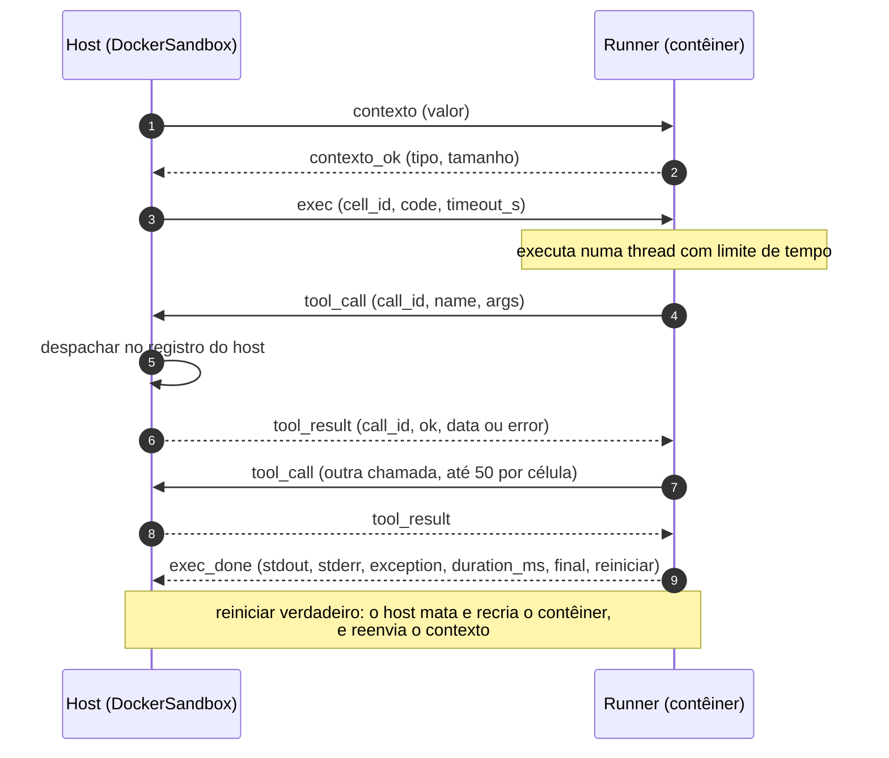

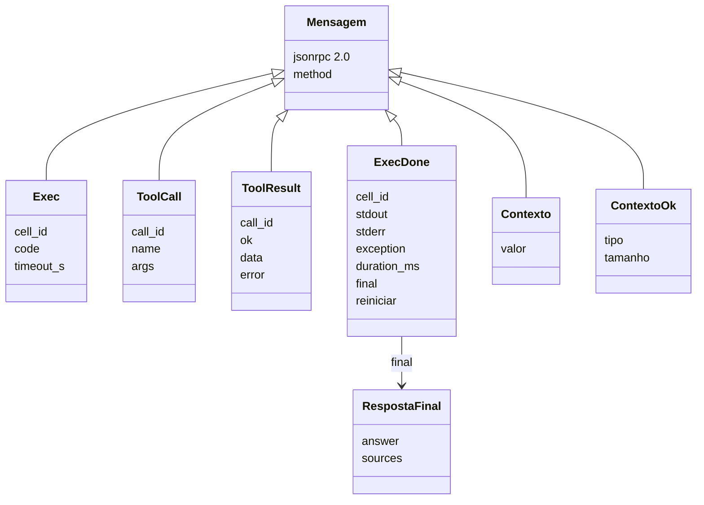

Direções: `exec` e `contexto` vão do host ao sandbox. `tool_call`, `exec_done` e `contexto_ok` vão do sandbox ao host. `tool_result` volta ao sandbox. Mensagem com campo extra, método desconhecido ou JSON quebrado vira erro de protocolo e o contêiner é descartado.

## 6. Contexto grande como variável

Entrada grande é dado do pedido, não código. O modelo vê só os metadados e uma prévia curta, e lê o resto com código.

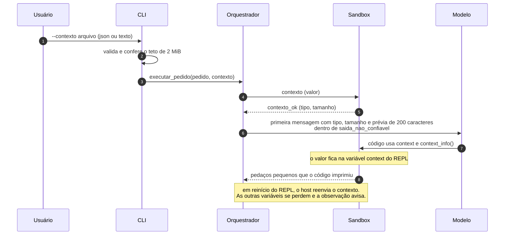

## 7. Cliente do modelo: repetições e prazo

Duas defesas diferentes: repetição para falha transitória e prazo total para a chamada nunca prender o loop.

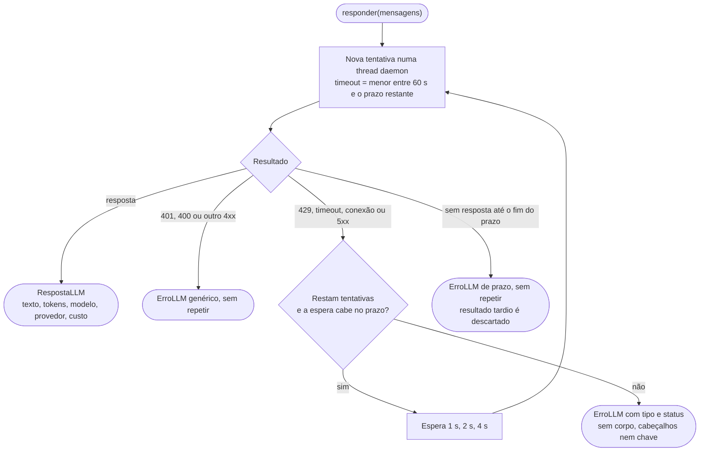

O prazo total padrão é 120 s (`OPENROUTER_PRAZO_TOTAL`) e precisa ser maior ou igual ao timeout por tentativa (60 s). O orquestrador transforma qualquer `ErroLLM` em `erro_llm`, sem o texto da exceção.

## 8. `FINAL` com fontes obrigatórias

O `FINAL` é a única forma de um pedido terminar com sucesso, e ele só vale com uma resposta e pelo menos uma fonte.

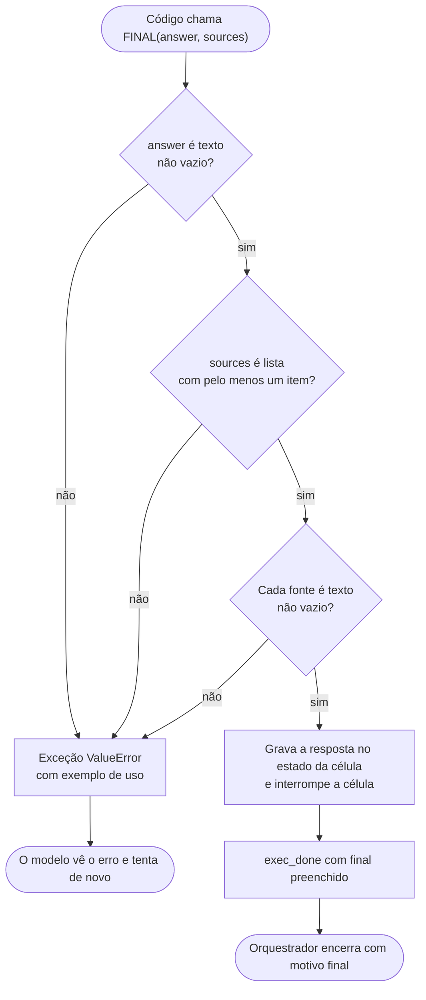

Um `FINAL` guardado de uma célula anterior não grava nada na célula atual: cada célula tem o seu estado de `FINAL`.

## 9. Eventos do trace

Cada pedido grava um arquivo JSONL, uma linha por evento, com flush a cada linha. Um pedido interrompido deixa um trace parcial mas válido.

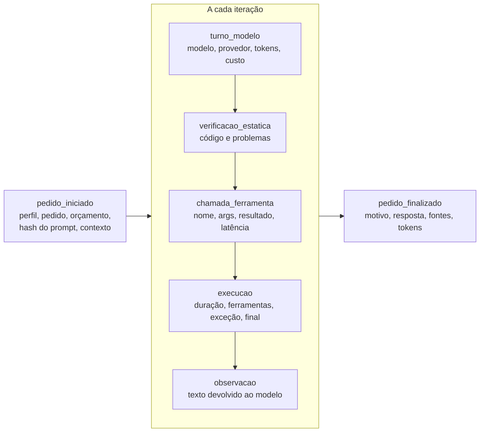

Toda linha traz `seq`, `ts`, `session_id`, `tipo` e `dados`. Falha de escrita nunca derruba o pedido: ela é contada em `falhas_de_escrita`, e o `seq` avança mesmo assim, então um buraco no arquivo sempre corresponde a uma falha. O trace não guarda a chave do OpenRouter nem o conteúdo do contexto (só tipo, tamanho e SHA-256).

## 10. Como a CLI monta tudo

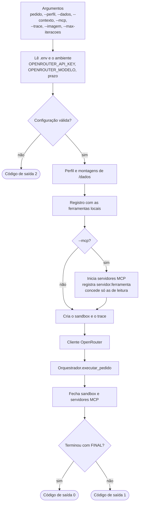

## 11. Mapa de módulos

Quem depende de quem. O sandbox é a única parte que roda no contêiner, e a imagem só leva o necessário.

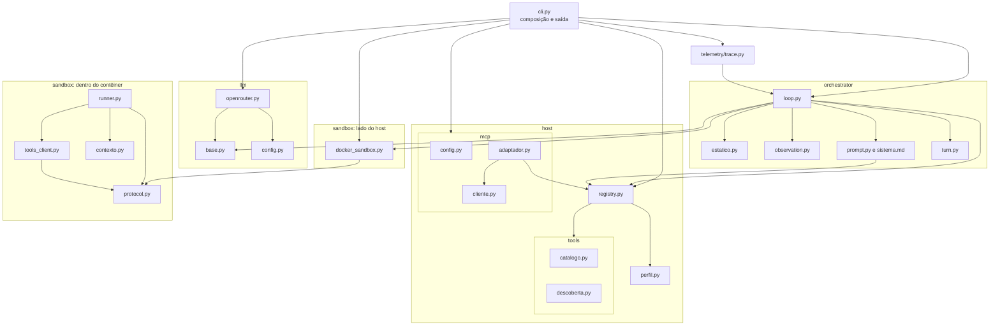

A imagem do sandbox leva só `runner`, `protocol`, `tools_client` e `contexto`. Nada de `harness/host`: o registro, as ferramentas e os perfis executam no host e nunca entram no contêiner.

## 12. Ciclo de vida de uma ferramenta, do cadastro à chamada

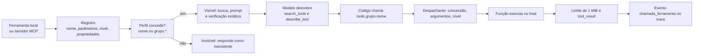

## Onde cada parte está no código

| Assunto | Arquivo |
| --- | --- |
| Loop, orçamento, estados e resumo final | [`harness/orchestrator/loop.py`](../harness/orchestrator/loop.py) |
| Formato dos turnos do modelo | [`harness/orchestrator/turn.py`](../harness/orchestrator/turn.py) |
| Prompt de sistema | [`harness/orchestrator/prompt.py`](../harness/orchestrator/prompt.py) |
| Protocolo da ponte | [`harness/sandbox/protocol.py`](../harness/sandbox/protocol.py) |
| Cliente do sandbox, reinício e contexto | [`harness/sandbox/docker_sandbox.py`](../harness/sandbox/docker_sandbox.py) |
| Runner e `FINAL` | [`harness/sandbox/runner.py`](../harness/sandbox/runner.py) |
| Cliente OpenRouter | [`harness/llm/openrouter.py`](../harness/llm/openrouter.py) |
| Trace JSONL | [`harness/telemetry/trace.py`](../harness/telemetry/trace.py) |
| Composição e saída da CLI | [`harness/cli.py`](../harness/cli.py) |
