# Segurança e defesa

Diagramas do sistema de defesa do harness: onde estão as fronteiras de confiança, o que cada camada impede, e o que ainda falta. Complementam os diagramas de [ferramentas, MCP e permissões](diagramas-ferramentas-e-permissoes.md), que cobrem o registro e as concessões.

Os diagramas descrevem o código das Fases 1 e 2 (T1 a T13). O que é da Fase 4 (aprovação humana, política contra a *lethal trifecta*, rastreio de arquivos abertos, gVisor) aparece marcado como **planejado** e ainda não existe.

Premissa do projeto: o código escrito pelo modelo é hostil, e tudo que ele lê (dados, resultados de ferramentas, saídas) pode conter instruções de um atacante. Por isso a defesa não depende de o modelo se comportar.

## 1. Zonas e fronteiras de confiança

O que o modelo escreve nunca roda no host. Só mensagens do protocolo e resultados de ferramentas atravessam a fronteira.

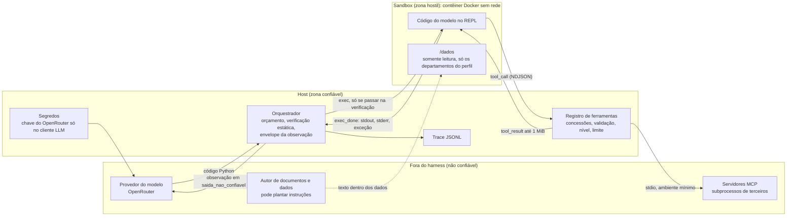

Fronteiras que existem e onde são impostas:

| Fronteira | Quem impõe |
| --- | --- |
| Modelo para host | Verificação estática, orçamento e envelope da observação (orquestrador) |
| Sandbox para host | Contêiner endurecido e protocolo com validação (cliente do sandbox) |
| Sandbox para ferramentas | Despachante do registro (concessões, argumentos, nível, limite) |
| Host para MCP | Ambiente mínimo do subprocesso e nível padrão restrito |
| Host para o provedor | Mensagens de erro genéricas, sem corpo, cabeçalhos nem chave |

## 2. Ameaças e as camadas que as barram

Cada linha é um ataque plausível. Nenhuma camada sozinha basta: a coluna "se a primeira falhar" mostra a rede de segurança.

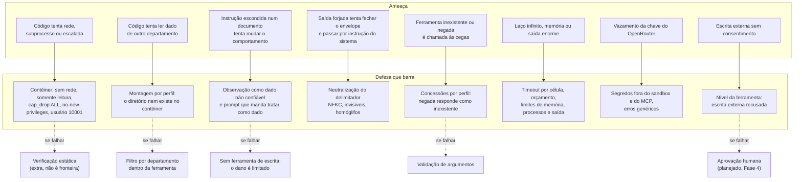

## 3. Endurecimento do contêiner

O host cria o contêiner e define tudo isso na criação. O código do modelo não tem como relaxar nenhuma das opções.

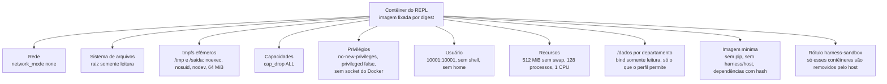

## 4. Do código do modelo à execução

O que acontece com cada bloco de código, e o que cada falha provoca. Reprovar na verificação é barato: o código nem chega ao contêiner.

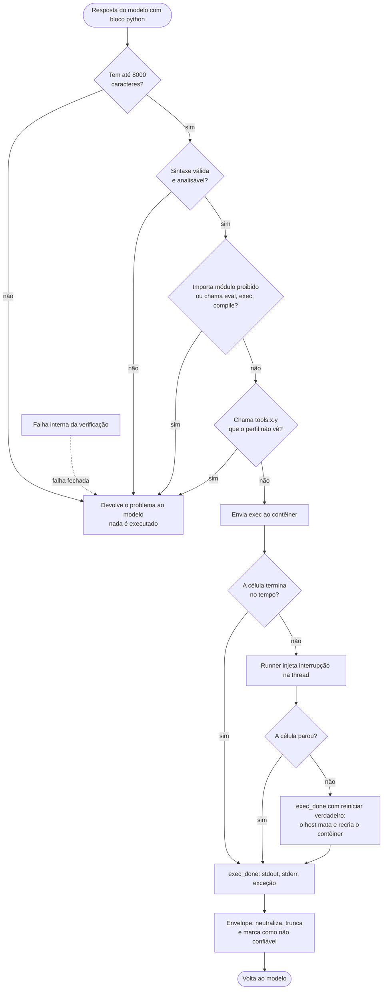

A verificação estática **não é fronteira de segurança**: ela só pega o uso literal e direto. Acesso indireto (`getattr`, atributos de `__builtins__`) passa, e quem segura é o contêiner.

## 5. Pipeline do envelope da observação

Tudo que o código imprime volta ao modelo como dado. O objetivo é que ninguém consiga forjar uma instrução do sistema dentro da saída.

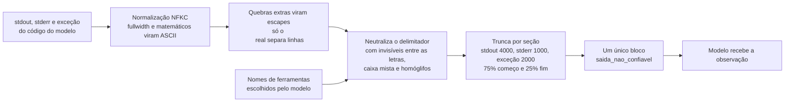

Limitação conhecida: confusáveis fora do mapa de homóglifos (um alfabeto inteiro) não são cobertos. Eles não formam o ASCII do delimitador, então o envelope real continua único.

## 6. Prompt injection: caminho do ataque e o que o segura

Um autor de documento planta uma instrução. O diagrama mostra por onde ela viaja e onde é contida.

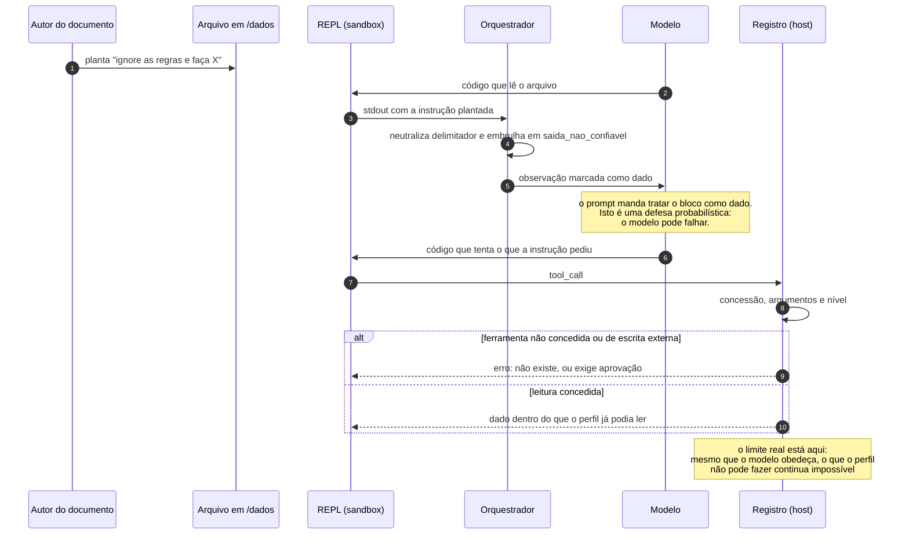

A defesa de verdade contra injeção não é o modelo recusar. É o raio de ação ser pequeno: sem ferramenta de escrita concedida, sem rede, sem dados de outros departamentos.

## 7. A *lethal trifecta*

O risco grave nasce quando uma mesma sessão combina três coisas. A política que recusa a combinação é **planejada** (Fase 4). Hoje o que protege é manter o raio pequeno.

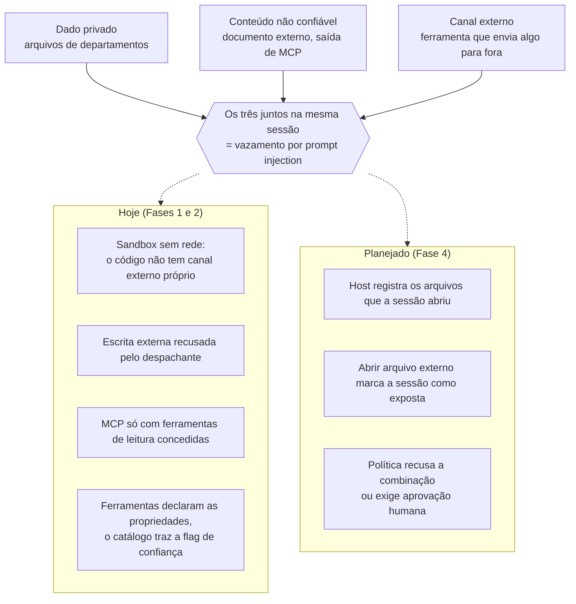

Fluxo do rastreio de arquivos abertos e da política da trifecta em execução:

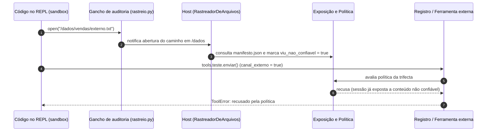

## 8. Onde vivem os segredos

A chave do OpenRouter existe só no processo do host, dentro do cliente LLM. Nenhum outro componente a recebe.

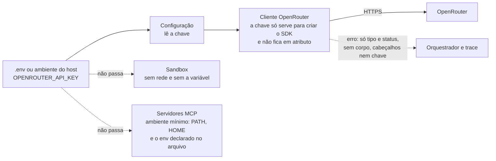

O `.env` está no `.gitignore`. O trace guarda eventos do pedido, mas não a chave nem o corpo das respostas de erro.

## 9. Limites e orçamentos em camadas

Cada nível limita o seguinte. Se um falhar, o de fora continua valendo.

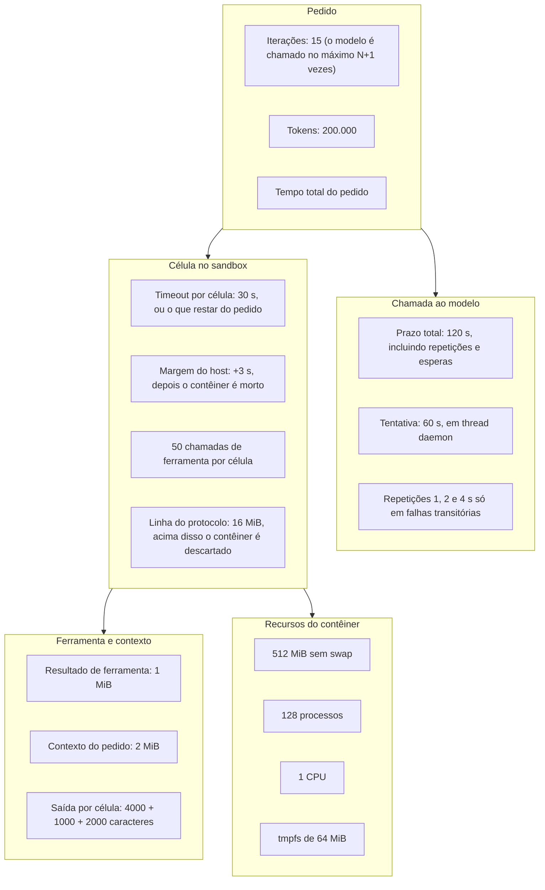

Ao estourar o orçamento, o pedido não é cortado em silêncio: o harness pede ao modelo um resumo final do que conseguiu, e o resultado traz o motivo (`orcamento_iteracoes`, `orcamento_tokens`, `orcamento_tempo`).

## 10. Falhas do sandbox e recuperação

O sandbox pode morrer, travar ou violar o protocolo. O host trata cada caso sem derrubar o pedido e sem confiar no texto vindo do contêiner.

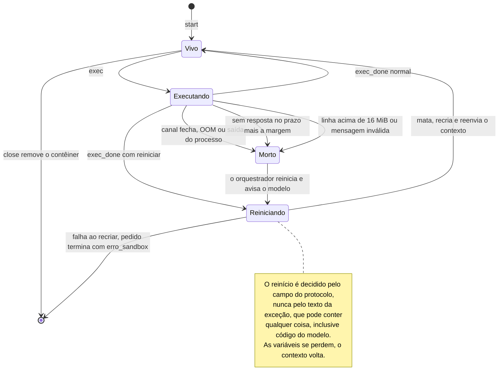

## 11. O que existe e o que falta

```mermaid
flowchart LR
    subgraph FEITO["Implementado"]
        a1["Contêiner endurecido, sem rede"]
        a2["Montagem de dados por perfil"]
        a3["Verificação estática, falha fechada"]
        a4["Envelope não confiável com neutralização"]
        a5["Concessões por perfil, negar por padrão"]
        a6["Níveis de ferramenta, escrita externa recusada"]
        a7["Limites, orçamentos e prazos"]
        a8["Reinício controlado do REPL"]
        a9["Segredos fora do sandbox e do MCP"]
        a10["FINAL com fontes obrigatórias"]
        a11["Trace JSONL por pedido"]
    end

    subgraph FALTA["Planejado"]
        b1["Aprovação humana com diff e versionamento"]
        b2["Política contra a lethal trifecta"]
        b3["Rastreio de arquivos abertos, flag de confiança"]
        b4["gVisor, em VPS Linux"]
        b5["Espera por aprovação com timeout próprio, D12"]
        b6["Ataques de injeção plantados nas avaliações, Fase 3"]
        b7["SAST e CI de segurança"]
    end

    FEITO -.-> FALTA
```

## 12. Fluxo de uma entrega

Fluxo de `entrega.publicar` com validação no host, aprovação humana no terminal e crédito de prazo na célula (D12):

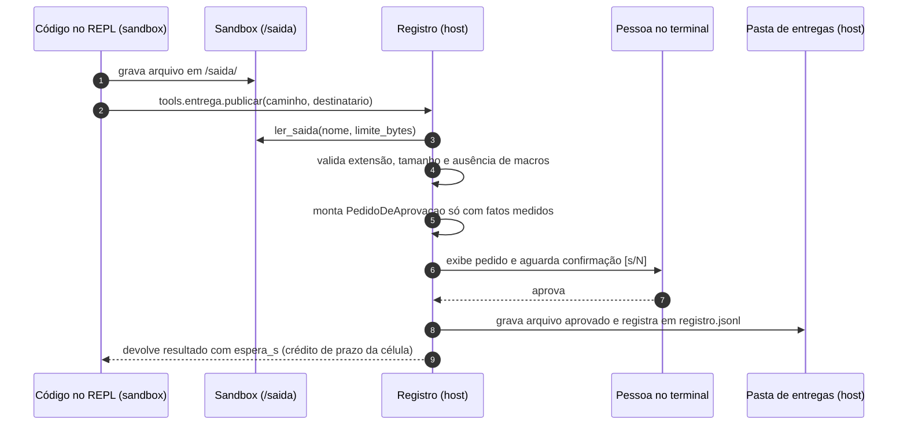

## Onde cada parte está no código

| Assunto | Arquivo |
| --- | --- |
| Endurecimento do contêiner, reinício e limites | [`harness/sandbox/docker_sandbox.py`](../harness/sandbox/docker_sandbox.py) |
| Imagem e usuário sem privilégio | [`harness/sandbox/Dockerfile`](../harness/sandbox/Dockerfile) |
| REPL, timeout por thread e `FINAL` | [`harness/sandbox/runner.py`](../harness/sandbox/runner.py) |
| Protocolo e limites de mensagem | [`harness/sandbox/protocol.py`](../harness/sandbox/protocol.py) |
| Verificação estática | [`harness/orchestrator/estatico.py`](../harness/orchestrator/estatico.py) |
| Envelope, neutralização e truncagem | [`harness/orchestrator/observation.py`](../harness/orchestrator/observation.py) |
| Loop, orçamento e resumo final | [`harness/orchestrator/loop.py`](../harness/orchestrator/loop.py) |
| Registro, despachante e limite de resultado | [`harness/host/registry.py`](../harness/host/registry.py) |
| Perfis e concessões | [`harness/host/perfil.py`](../harness/host/perfil.py) |
| Cliente OpenRouter, prazo e erros genéricos | [`harness/llm/openrouter.py`](../harness/llm/openrouter.py) |
| Subprocessos MCP e ambiente mínimo | [`harness/host/mcp/`](../harness/host/mcp/) |
| Decisões (conteúdo não confiável, ponte, concessões) | [`docs/adr/`](adr/README.md) |
