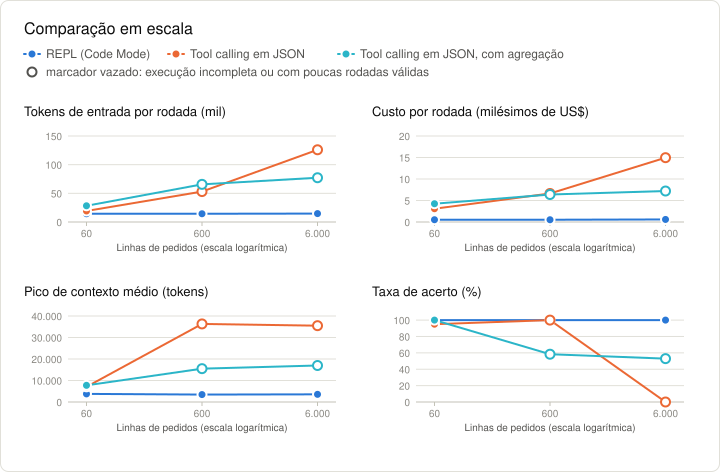

# Cálculos fora do repertório da agregação, em escala

O [experimento de escala](escala-de-dados.md) mostrou o JSON com agregação quase plano, mas só porque os casos eram somas e filtros, que a ferramenta `arquivos.agregar_planilha` resolve no host. Este experimento faz a pergunta que ficou aberta: o que acontece quando o cálculo **não** está no repertório da ferramenta (soma, contagem, média, máximo, mínimo, com filtros e agrupamento)?

**Versão interativa, com mouseover:** [cristianoncarvalho.github.io/agent-repl-security/relatorios/escala-calculo/graficos.html](https://cristianoncarvalho.github.io/agent-repl-security/relatorios/escala-calculo/graficos.html)

## O que foi testado

- Conjunto de **4 casos de cálculo** (`--conjunto calculo`), fora do conjunto congelado v1: mediana dos pedidos válidos, região com a maior mediana (e o valor), desvio-padrão populacional, e um controle (cliente com maior valor total de pedidos válidos).
- Escalas **1, 10 e 100** (60, 600 e 6.000 linhas), 5 rodadas por caso (20 rodadas por execução), semente 42, DeepSeek V4.1 Flash, provedor Wafer.
- As três variantes: REPL (Code Mode), JSON básico e JSON com agregação.
- Mediana e desvio-padrão não existem na ferramenta de agregação, então o agente do JSON precisa ler as linhas e calcular por conta própria. O controle usa só soma e agrupamento, e é resolvível pela ferramenta.

## Resultado



As rodadas com `erro_infra` são chamadas ao modelo que passaram do prazo de 120 s. O acerto abaixo conta só as rodadas válidas (aprovadas e reprovadas).

| Escala (linhas) | Variante | Aprovadas / reprovadas / infra | Acerto nas rodadas válidas | Custo por rodada (milésimos de US$) |
| --- | --- | --- | --- | --- |
| 1 (60) | REPL (Code Mode) | 20 / 0 / 0 | 100% | 0,53 |
| | JSON básico | 19 / 1 / 0 | 95% | 3,09 |
| | JSON com agregação | 20 / 0 / 0 | 100% | 4,25 |
| 10 (600) | REPL (Code Mode) | 20 / 0 / 0 | 100% | 0,53 |
| | JSON básico | 7 / 0 / **13** | 100% (7 rodadas) | 6,64 |
| | JSON com agregação | 7 / 5 / **8** | 58% | 6,40 |
| 100 (6.000) | REPL (Code Mode) | 20 / 0 / 0 | 100% | 0,60 |
| | JSON básico | 0 / 13 / 7 | **0%** | **14,96** |
| | JSON com agregação | 9 / 8 / 3 | 53% | 7,21 |

## Leitura

1. **O REPL (Code Mode) resolve o que a ferramenta não prevê.** Mediana e desvio-padrão são poucas linhas de Python no sandbox. 100% de acerto e custo plano (cerca de US$ 0,0005 por rodada) de 60 a 6.000 linhas. Em 6.000 linhas, o REPL custa 25 vezes menos por rodada que o JSON básico e 12 vezes menos que o JSON com agregação.
2. **O JSON com agregação perde a vantagem fora do repertório.** Em 60 linhas ainda acerta (o agente lê os 54 valores e calcula de cabeça), mas já é a variante mais cara. Com 600 e 6.000 linhas a ferramenta não ajuda, o agente volta a ler linhas, e o acerto cai para 58% e 53%.
3. **O JSON básico é limitado pelo volume, não pela impossibilidade.** Com 60 linhas ele calcula médias e desvios mentalmente e acerta 95%. Com 600 linhas, 13 de 20 rodadas estouram o prazo de 120 s; com 6.000 linhas, nenhuma rodada fecha com acerto.
4. **A agregação que ajudou na [comparação anterior](escala-de-dados.md) era um caso particular.** O ganho do JSON com agregação vale enquanto a pergunta cabe na ferramenta. Cada cálculo novo exige uma ferramenta nova no host, que também precisa ser mantida e protegida. No REPL, o código resolve sem ferramenta nova.

## Ressalvas

- **Muitas rodadas com erro de infraestrutura no JSON.** O prazo de 120 s por chamada ao modelo anula 13 das 20 rodadas do JSON básico na escala 10 e 8 do JSON com agregação. O "100%" do JSON básico na escala 10 vale para 7 rodadas, e os marcadores vazados no gráfico indicam isso. Um prazo maior mediria o JSON com mais rodadas válidas, mas o custo cresceria junto.
- **Uma execução por escala e variante, 5 rodadas por caso, só 4 casos.** As taxas de poucas rodadas válidas têm erro grande. O padrão (REPL plano, JSON degradando) é grande demais para ser ruído, mas os números exatos não são conclusivos.
- **Primeira passada descartada.** As rodadas de escala 100 da primeira tentativa falharam por falta de créditos no OpenRouter (HTTP 402) e foram substituídas pela repetição. Vêm da primeira passada as três variantes na escala 1 e o REPL na escala 10; o restante vem da repetição.
- **Um modelo.** O resultado vale para o DeepSeek V4.1 Flash.
- **Nenhuma é linha de base.** O conjunto de cálculo não é congelado e as execuções não são comparáveis às do conjunto v1.
- **Árvore com mudanças sem commit** em algumas execuções (a procedência do relatório marca `commit_sujo`). Elas não afetam o resultado.

## O que isso muda

Com a [escala de dados](escala-de-dados.md), o REPL (Code Mode) mostrou economia de contexto. Aqui ele mostra também **generalidade**: a mesma ferramenta (executar código) resolve perguntas que a agregação no host não prevê, sem custo extra de manutenção. O ponto fraco do REPL continua sendo o custo de exploração em escala pequena ([backlog](../backlog.md), B1 e B2).

Próximos testes naturais: repetir o JSON com um prazo maior por chamada (para medir com mais rodadas válidas), outro modelo, e casos de cálculo mais próximos de regras de negócio.

## Como regenerar

```bash
A=avaliacoes/avaliacao-20261124
uv run python -m harness.evals graficos --de-relatorios \
  $A-184211-semente42.json $A-185553-semente42.json $A-200000-semente42.json \
  $A-185008-semente42.json $A-204115-semente42.json $A-212603-semente42.json \
  $A-185219-semente42.json $A-203546-semente42.json $A-203254-semente42.json \
  --saida docs/relatorios/escala-calculo
```

Os relatórios completos ficam em `avaliacoes/` (fora do git).
