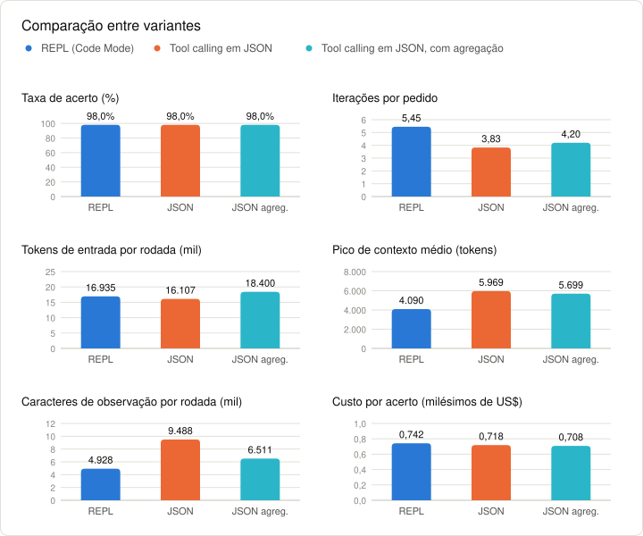

# Comparação entre REPL (Code Mode) e tool calling em JSON

Três agentes sobre os mesmos 20 casos ativos, 5 rodadas cada (100 rodadas por variante), semente 42, modelo DeepSeek V4.1 Flash, provedor Wafer, dados sintéticos de 60 linhas. Execuções de 23 e 24/11/2026, sem erro de infraestrutura.

**Versão interativa, com mouseover:** [cristianoncarvalho.github.io/agent-repl-security/relatorios/comparacao-variantes/graficos.html](https://cristianoncarvalho.github.io/agent-repl-security/relatorios/comparacao-variantes/graficos.html)

As variantes:

- **REPL (Code Mode):** o modelo escreve Python e o sandbox executa.
- **JSON:** tool calling nativo, com `catalogo.listar`, `arquivos.ler_planilha`, `arquivos.ler_documento` e `finalizar`.
- **JSON com agregação:** as mesmas, mais `arquivos.agregar_planilha`, que filtra, agrupa e soma no host.

## Resultado



| Medida | REPL (Code Mode) | JSON | JSON com agregação |
| --- | --- | --- | --- |
| Taxa de acerto | 98,0% | 98,0% | 98,0% |
| Iterações por pedido | 5,45 | **3,83** | 4,20 |
| Tokens de entrada | 1,69 mi | **1,61 mi** | 1,84 mi |
| Tokens de saída | 92,7 mil | 99,5 mil | 92,7 mil |
| Pico de contexto médio (tokens) | **4.090** | 5.969 | 5.699 |
| Observação no contexto (caracteres por rodada) | **4.928** | 9.488 | 6.511 |
| Custo total (US$) | 0,0727 | 0,0704 | **0,0694** |
| Custo por acerto (US$) | 0,00074 | 0,00072 | **0,00071** |

## Leitura

1. **Acerto igual.** Com 100 rodadas por variante, 98% nas três está dentro do ruído. O `comparar` entre as duas rodadas do REPL e o JSON mostra todos os grupos "dentro do ruído".
2. **Custo praticamente igual.** A diferença total é de cerca de 5% (US$ 0,069 a 0,073). Nesta escala o custo não separa as variantes.
3. **A economia de contexto do REPL aparece onde se esperava:** o pico de contexto é 30% menor que o do JSON (4,1 mil contra 5,7 a 6,0 mil tokens) e a observação que entra no contexto é a metade (4,9 mil contra 9,5 mil caracteres). O REPL filtra e soma no código e devolve só o resultado.
4. **Mas o REPL gasta mais turnos.** 5,45 iterações contra 3,83, porque explora os arquivos antes de calcular. Cada turno reenvia o histórico, e isso compensa o contexto menor. É o que o B1 e o B2 do [backlog](../backlog.md) atacam.
5. **A agregação no host aproxima o JSON do REPL** (observação de 9,5 mil para 6,5 mil caracteres), mas é uma ferramenta a mais para manter e proteger, e o modelo ainda gasta turnos para pedi-la.

## Falhas

- REPL, 2 rodadas: `cruzamento-01` (1) e `permissao-03` (1), ambas de cálculo ou formulação do modelo.
- JSON: `permissao-03` em 2 rodadas. O modelo chamou `catalogo.listar` com `departamento: ">financeiro"`, a mensagem de erro não dizia o que era válido e três turnos inválidos seguidos encerram o pedido. É a fraqueza típica do tool calling: validação de esquema com retorno pobre.
- JSON com agregação: `cruzamento-05` (valor errado) e `permissao-01`, em que o agente recusou com uma frase fora do vocabulário do corretor ("Não foi possível apurar"). Esta é falha do corretor, não do agente.

`permissao-03` é o caso mais frágil nas três variantes.

## Ressalvas

- **Uma execução por variante, no mesmo modelo.** A diferença entre as duas rodadas do REPL (US$ 0,0691 e 0,0727; 98% e 100%) dá a medida do ruído: diferenças de poucos por cento não são conclusivas.
- **Escala pequena.** Com 60 linhas por planilha, o volume de dados quase não pesa. A tese de economia de contexto só se testa de fato com dados maiores (T18c).
- **As ferramentas de arquivo do JSON existem só para o eval**, rodando no host. Não fazem parte do harness de produção.
- **O corretor** foi ampliado várias vezes; os números das três variantes usam o mesmo corretor.

## Como regenerar

```bash
uv run python -m harness.evals graficos --de-relatorios \
  avaliacoes/avaliacao-20261124-085043-semente42.json \
  avaliacoes/avaliacao-20261123-205459-semente42.json \
  avaliacoes/avaliacao-20261123-205508-semente42.json
```

Os relatórios completos ficam em `avaliacoes/` (fora do git). As linhas de base estão em `evals/linhas-de-base/`.
