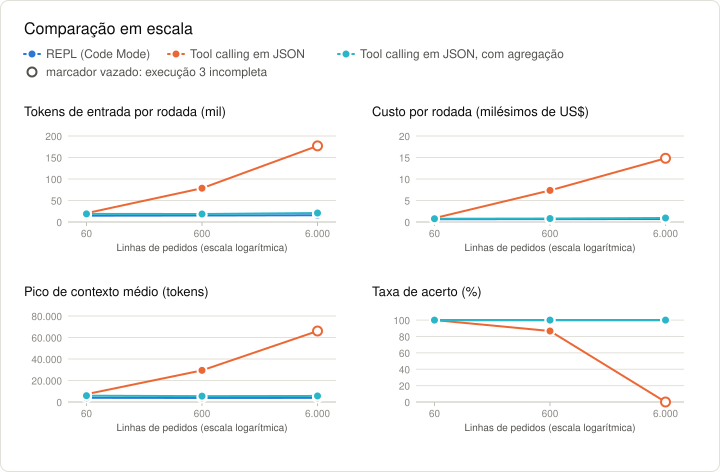

# Escala dos dados: REPL (Code Mode) contra tool calling em JSON

A [comparação anterior](comparacao-variantes.md) usou planilhas pequenas (60 linhas de pedidos) e não separou as variantes no custo. Este experimento repete o teste aumentando o volume de dados, para ver o que a economia de contexto do REPL (Code Mode) vale quando as fontes crescem.

**Versão interativa, com mouseover:** [cristianoncarvalho.github.io/agent-repl-security/relatorios/escala-de-dados/graficos.html](https://cristianoncarvalho.github.io/agent-repl-security/relatorios/escala-de-dados/graficos.html)

## O que foi testado

- O gerador de dados ganhou o parâmetro `escala` (T18c-a): a planilha de pedidos passa de 60 linhas para 60 × N, e o resto dos arquivos fica igual. Escala 1 gera exatamente os mesmos bytes de antes.
- Escalas **1, 10 e 100**: 60, 600 e 6.000 linhas, de 6 KB a 231 KB na planilha de pedidos.
- Só as categorias que leem os pedidos: **Consulta e Cruzamento** (10 casos), 3 rodadas por caso, semente 42, DeepSeek V4.1 Flash, provedor Wafer.
- As três variantes: REPL (Code Mode), JSON básico e JSON com agregação (`arquivos.agregar_planilha`, que filtra e soma no host).

Os casos têm gabarito calculado a partir dos fatos de cada escala, e os pedidos extras respeitam o mesmo teto de valor para preservar a armadilha do `consulta-04`. O conjunto congelado v1 vale só para a escala 1, então estas execuções não são linhas de base.

## Resultado



| Escala (linhas) | Variante | Acerto | Tokens de entrada por rodada | Custo por rodada (milésimos de US$) | Pico de contexto (tokens) |
| --- | --- | --- | --- | --- | --- |
| 1 (60) | REPL (Code Mode) | 100% | 14,7 mil | 0,65 | 3.905 |
| | JSON básico | 100% | 20,6 mil | 0,91 | 7.304 |
| | JSON com agregação | 100% | 18,9 mil | 0,76 | 5.879 |
| 10 (600) | REPL (Code Mode) | 100% | 15,1 mil | 0,67 | 3.768 |
| | JSON básico | 86,7% | **78,6 mil** | **7,35** | **29.424** |
| | JSON com agregação | 100% | 18,6 mil | 0,81 | 5.438 |
| 100 (6.000) | REPL (Code Mode) | 100% | 15,7 mil | 0,68 | 3.830 |
| | JSON básico | **0%** (incompleto) | **177 mil** | **14,82** | **66.032** |
| | JSON com agregação | 100% | 20,9 mil | 0,93 | 5.627 |

## Leitura

1. **O REPL (Code Mode) ficou plano.** De 60 a 6.000 linhas, os tokens por rodada foram de 14,7 mil para 15,7 mil e o contexto ficou em cerca de 3,8 mil tokens. O código filtra e soma dentro do sandbox, e só o resultado volta ao modelo.
2. **O JSON básico cresce com os dados e acaba falhando.** Em 600 linhas o custo por rodada foi 11 vezes o da escala 1 e o acerto caiu para 86,7%. Em 6.000 linhas, 0%: `ler_planilha` entrega 200 linhas por chamada (30 chamadas para ler tudo), cada turno reenvia o histórico, o contexto chega a mais de 100 mil tokens, o orçamento de 200 mil tokens da rodada acaba sem resposta (`orcamento_tokens`), e algumas chamadas ao modelo passam do prazo de 120 s.
3. **O JSON com agregação também ficou quase plano** (US$ 0,76 a 0,93 milésimos por rodada). A soma acontece no host e o modelo não lê as linhas. Foi a ferramenta certa para estes casos, e o custo é de manter e proteger uma ferramenta a mais.
4. **Cuidado com o que a agregação esconde.** Os casos de Consulta e Cruzamento são justamente somas, filtros e agrupamentos. Uma pergunta fora do repertório da ferramenta (uma conta nova, uma regra de negócio) faria o agente voltar a ler linhas, e o REPL resolveria com código. Este experimento **não mediu** esse cenário.

## Ressalvas

- **Execução incompleta:** o JSON básico na escala 100 estourou o teto de 4 milhões de tokens. Das 30 rodadas, 21 rodaram (5 com erro de infraestrutura por prazo do modelo) e 9 nem começaram. O ponto está com marcador vazado no gráfico. O 0% é um indício forte, mas não um número exato.
- **3 rodadas por caso e uma execução por escala.** Diferenças pequenas (como 100% contra 100%) não são conclusivas. O padrão de crescimento do JSON básico é grande demais para ser ruído.
- **Só duas categorias.** Conformidade e Permissão não leem os pedidos e não entraram.
- **Um modelo.** O resultado vale para o DeepSeek V4.1 Flash. Um modelo com mais contexto e mais fôlego para tool calling poderia adiar a quebra, mas não mudaria o crescimento do custo.
- **Árvore com mudanças sem commit** nas execuções (a procedência do relatório marca `commit_sujo`). Elas não afetam o resultado, e nenhuma é linha de base.

## O que isso muda

A tese do REPL (Code Mode), de que a economia de contexto compensa o custo de exploração, **se confirma com volume**: a vantagem de contexto que ficou pequena em 60 linhas (30%) vira uma diferença de 17 vezes em 6.000 linhas. O custo de exploração do REPL (mais turnos) continua sendo o ponto fraco em escala pequena, e é o que o B1 e o B2 do [backlog](../backlog.md) atacam.

Próximos testes naturais: uma pergunta fora do repertório da agregação; escalas maiores (a ferramenta JSON recusa planilhas acima de 50.000 linhas, na escala 834); e outro modelo.

## Como regenerar

```bash
uv run python -m harness.evals graficos --de-relatorios \
  avaliacoes/avaliacao-20261124-093429-semente42.json \
  avaliacoes/avaliacao-20261124-093508-semente42.json \
  avaliacoes/avaliacao-20261124-093448-semente42.json \
  avaliacoes/avaliacao-20261124-094023-semente42.json \
  avaliacoes/avaliacao-20261124-101158-semente42.json \
  avaliacoes/avaliacao-20261124-094036-semente42.json \
  avaliacoes/avaliacao-20261124-101711-semente42.json \
  avaliacoes/avaliacao-20261124-101653-semente42.json \
  avaliacoes/avaliacao-20261124-111330-semente42.json \
  --saida docs/relatorios/escala-de-dados
```

Os relatórios completos ficam em `avaliacoes/` (fora do git).
