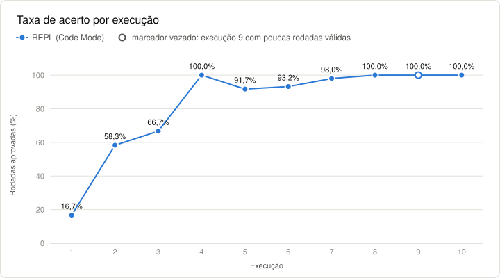
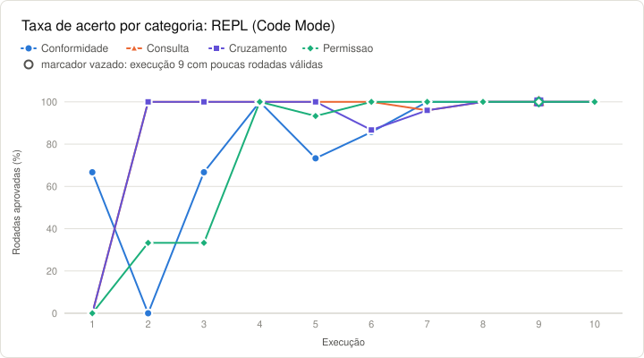
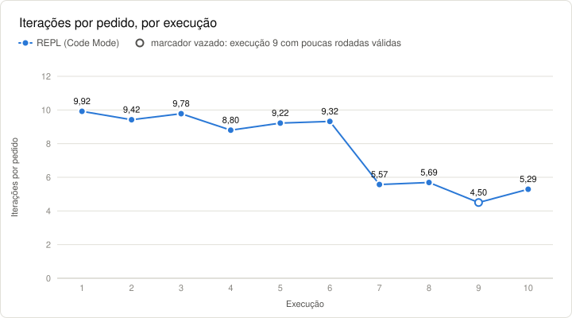
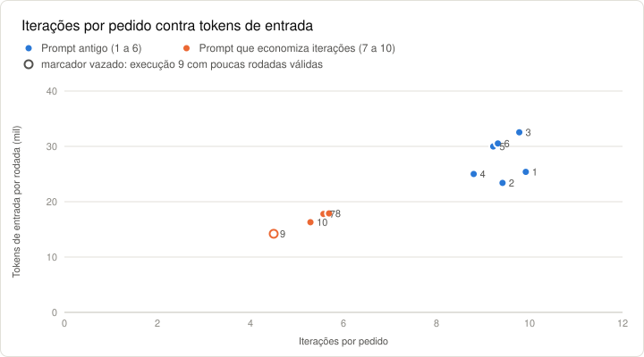
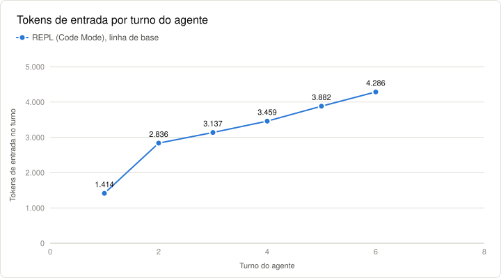
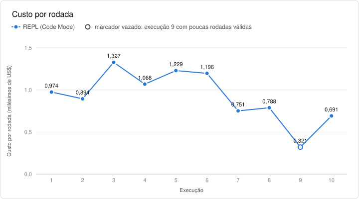

# Gráficos das avaliações

Seis gráficos XY das dez execuções reais dos evals (de 21 a 23/11/2026), com o modelo DeepSeek V4.1 Flash e dados sintéticos. Servem para ver a evolução e, depois, para comparar o REPL (Code Mode) com o tool calling em JSON nos mesmos eixos.

**Versão interativa, com mouseover:** [cristianoncarvalho.github.io/agent-repl-security/relatorios/graficos/graficos.html](https://cristianoncarvalho.github.io/agent-repl-security/relatorios/graficos/graficos.html). O GitHub mostra as imagens abaixo como figuras estáticas, e a página acima mostra o valor de cada ponto ao passar o mouse (ou tocar, ou usar o Tab).

Os dados de cada gráfico estão em [dados/evolucao-execucoes.json](dados/evolucao-execucoes.json). A taxa de acerto é calculada sobre as rodadas válidas, sem contar erros de infraestrutura.

## O que mudou antes de cada execução

| # | Casos × rodadas | O que mudou antes |
| --- | --- | --- |
| 1 | 4 × 3 | Primeira execução real |
| 2 | 4 × 3 | Corretor aceita fonte com prefixo e anotação, regra de texto exato e caso de Permissão com dado inacessível |
| 3 | 4 × 3 | Cliente do modelo repete respostas vazias |
| 4 | 4 × 5 | Prompt proíbe chamadas nativas, recusa mais ampla e motivo do erro no trace |
| 5 | 20 × 3 | Conjunto de 20 casos (T17a) |
| 6 | 20 × 3 | Gabaritos corrigidos e recusa ampliada |
| 7 | 20 × 5 | Prompt que economiza iterações |
| 8 | 13 × 1 | Primeira execução com telemetria no Langfuse |
| 9 | 20 × 5 | O provedor mudou sozinho para Tenstorrent: 86% das rodadas com erro 429 |
| 10 | 20 × 5 | Provedor fixo (Wafer): primeira linha de base |

## 1. Taxa de acerto por execução



O acerto sobe de 16,7% para 100% em quatro execuções, cai para 91,7% quando o conjunto passa de 4 para 20 casos, mais difíceis, e volta a 98% e 100%. Quase todo esse ganho foi corrigir a régua (corretor, gabaritos e dados), e não o agente melhorar. O marcador vazado da execução 9 indica que só 14 rodadas foram válidas, então o 100% dela vale pouco.

## 2. Taxa de acerto por categoria



Consulta e Cruzamento chegam a 100% cedo. Conformidade e Permissão são as que demoram, e em cada queda o motivo estava no corretor ou no gabarito.

## 3. Iterações por pedido



Um degrau: de cerca de 9 a 10 iterações até a execução 6 para 5,3 a 5,7 a partir da 7, quando entrou o prompt que economiza iterações. O 4,5 da execução 9 é enviesado, porque só as primeiras chamadas sobreviveram aos erros 429.

## 4. Iterações contra tokens de entrada



Duas nuvens bem separadas. Com cerca de 9 iterações, o REPL gasta de 23 a 33 mil tokens de entrada por rodada, e com cerca de 5, de 14 a 18 mil: umas 3 mil por iteração. O custo é dominado pela quantidade de turnos, porque cada um reenvia o histórico, e não pelo tamanho dos dados.

## 5. Contexto ao longo dos turnos



Curva de contexto do REPL na linha de base: 1.414 tokens no turno 1 e 2.836 no turno 2. A listagem de arquivos sozinha soma uns 1.400 tokens, e depois o contexto sobe de 300 a 450 por turno. Esta é a curva que o agente JSON vai desafiar.

## 6. Custo por rodada



O custo acompanha as iterações: cai de cerca de US$ 0,001 para US$ 0,0007 por rodada depois do ajuste de prompt.

## Ressalvas para ler os gráficos

- **O eixo X não é uma série temporal limpa.** As execuções 1 a 4 usam 4 casos, as de 5 em diante usam 20, e a 8 rodou só 13.
- **Cada execução mudou mais de uma coisa**, então a comparação entre vizinhas mostra o efeito do conjunto das mudanças.
- **Com poucas rodadas, o ruído é grande.** Diferenças de poucos pontos não são conclusivas (veja a margem de ruído no [guia dos evals](../guia-dos-evals.md)).

## Como regenerar

Os gráficos são gerados do arquivo de dados, sem bibliotecas externas:

```bash
uv run python -m harness.evals graficos docs/relatorios/dados/evolucao-execucoes.json
```

O comando escreve os seis SVGs e o `graficos.html` em `docs/relatorios/graficos/`. O formato aceita várias variantes (`repl`, `json`), e cada uma ganha a sua linha e a sua cor nos mesmos eixos. É assim que a comparação com o tool calling em JSON, a T18, vai aparecer.
